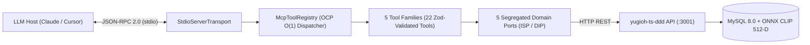

# 🤖 Yu-Gi-Oh! GX Tag Force — Model Context Protocol Server (`yugi-mcp` v2.0)

[](https://github.com/marcgaya98/yugi-mcp/actions/workflows/ci.yml)
[](./docker-compose.yml)
[](https://modelcontextprotocol.io)
[](./tsconfig.json)
[](./TOOLS.md)
[](https://opensource.org/licenses/MIT)

> **Elevator Pitch:** Zero-noise **Model Context Protocol (MCP)** gateway that equips LLM agents (Claude Desktop, Cursor, Windsurf, custom AI workflows) with **22 strongly-typed domain and multimodal CLIP visual search tools** over JSON-RPC 2.0 `stdio`.

### 🌐 Ecosystem Repositories

| Repository | Role | Stack |
|---|---|---|
| **[`yugi-mcp`](https://github.com/marcgaya98/yugi-mcp)** *(this repo)* | Model Context Protocol (MCP) Server exposing 22 tools to LLM Agents | TypeScript, MCP SDK (`stdio`), Zod |
| **[`yugioh-ts-ddd`](https://github.com/marcgaya98/yugioh-ts-ddd)** | Core DDD REST API & Multimodal CLIP (`512-D`) Vector Search Engine | TypeScript, Express 5, Sequelize, MySQL 8, ONNX CLIP |
| **[`card-analysis`](https://github.com/marcgaya98/card-analysis)** | Multi-Label Deep Learning Card Mechanics Classifier (`11 genres`) | Python 3.11, PyTorch, RoBERTa, FastAPI |

---

## 1. Live Demo



---

## 2. System Architecture



### 22 Registered MCP Tools by Domain Family

| Domain Family | Port Interface (ISP) | Tools Exposed (`22 Total`) |
|---|---|---|
| **Catalog (`3`)** | `CatalogApiPort` | `get_card_details`, `search_cards`, `get_catalog_metadata` |
| **Obtention & Exclusives (`10`)** | `ObtentionApiPort` | `get_card_obtention_methods`, `list_obtention_methods`, `get_cards_by_obtention_method`, `get_exclusive_cards_by_method`, `list_packs`, `get_character_reward_cards`, `get_converter_cards`, `get_tutorial_cards`, `get_initial_deck_cards`, `get_sandwich_cards` |
| **Multimodal CLIP Search (`4`)** | `SemanticSearchApiPort` | `search_cards_by_visual_description`, `find_visually_similar_cards`, `search_cards_by_visual_style`, `get_clip_search_stats` |
| **Duelists & Decks (`3`)** | `DuelistApiPort` | `list_characters`, `get_character_decks`, `get_deck_details` |
| **Banlists & Game Stats (`2`)** | `LimitListAndStatsApiPort` | `get_limit_list_stats`, `get_game_stats` |

> Full schema documentation and example payloads for all 22 tools are available in **[`TOOLS.md`](./TOOLS.md)**.

---

## 3. Technical Decisions & Trade-offs (ADRs)

### ADR-01: `stdio` Transport with Strict `stderr` Telemetry Isolation vs. WebSockets / SSE
- **Context:** Local AI coding assistants and desktop LLM hosts (Claude Desktop, Cursor) spawn MCP servers as child processes and communicate via standard streams (`stdin` / `stdout`). Any accidental `console.log()` or framework banner written to `stdout` corrupts the JSON-RPC 2.0 framing and crashes the agent connection.
- **Decision:** Adopted `StdioServerTransport` paired with a dedicated [`McpLogger`](./src/utils/mcp-logger.ts) that routes 100% of operational logs and error diagnostics exclusively to `process.stderr`.
- **Trade-off:** Requires discipline against third-party libraries writing to `stdout`, but guarantees **zero port conflicts**, **zero TLS/auth configuration**, and **instant lifecycle management** by any MCP-compliant host.

### ADR-02: Dynamic `McpToolRegistry` (OCP) & Segregated Ports (ISP) vs. Monolithic Switch Dispatcher
- **Context:** Early MCP server prototypes rely on a single giant `switch (request.params.name)` block coupled to a monolithic HTTP client, violating Open/Closed (OCP) and Interface Segregation (ISP) principles.
- **Decision:** Implemented [`McpToolRegistry`](./src/utils/tool-registry.ts) backed by an $O(1)$ `Map<string, McpToolDefinition>` where each tool encapsulates its own JSON Schema descriptor, Zod runtime validator, and async handler injected with a narrow domain port (`CatalogApiPort`, `SemanticSearchApiPort`, etc.).
- **Trade-off:** Adding a new MCP tool requires **zero modifications** to [`server.ts`](./src/server.ts) and allows unit testing all 22 tools in `< 150 ms` using an in-memory mock port.

---

## 4. Single-Command Quickstart

Run the containerized MCP server in a single command:

```bash
docker compose up --build
```

### Connect to Claude Desktop / Cursor (`mcp-config.json`)

```json
{
  "mcpServers": {
    "yugioh": {
      "command": "node",
      "args": ["/absolute/path/to/yugi-mcp/dist/server.js"],
      "env": {
        "YUGIOH_API_BASE_URL": "http://localhost:3001/api"
      }
    }
  }
}
```

---

## 5. Local Development & Testing

```bash
# Install dependencies
npm install

# Compile TypeScript to dist/
npm run build

# Run unit & live E2E integration tests
npm test
```

## License

Released under the [MIT License](https://opensource.org/licenses/MIT).
